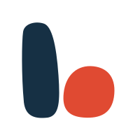
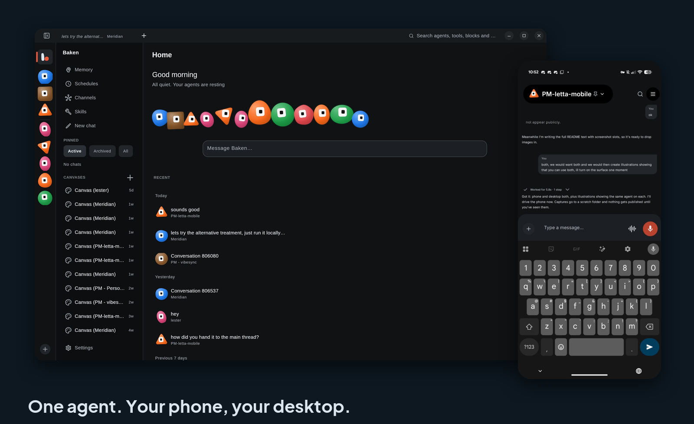
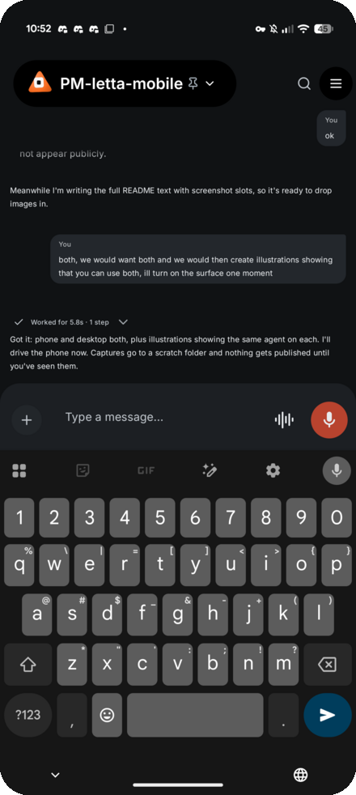
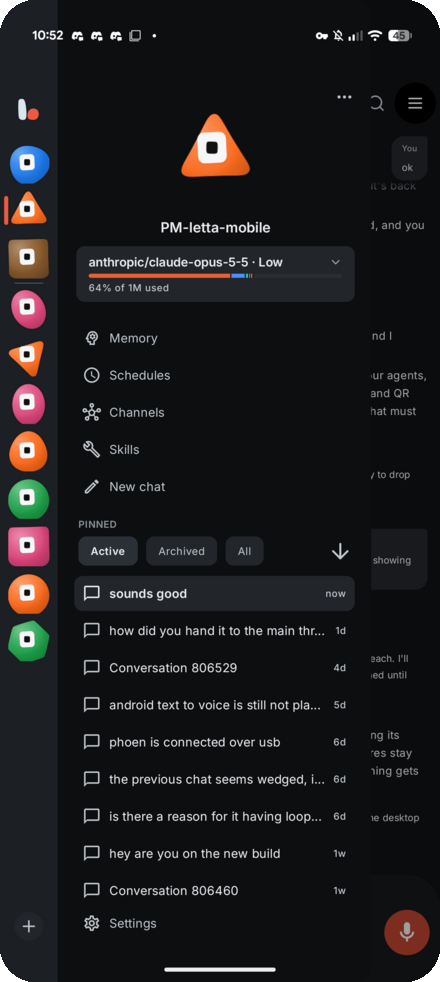
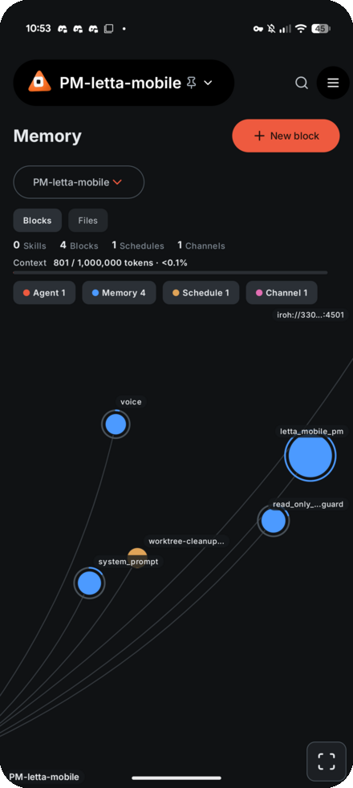
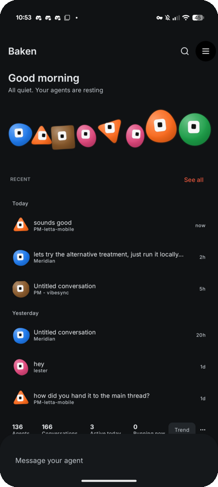
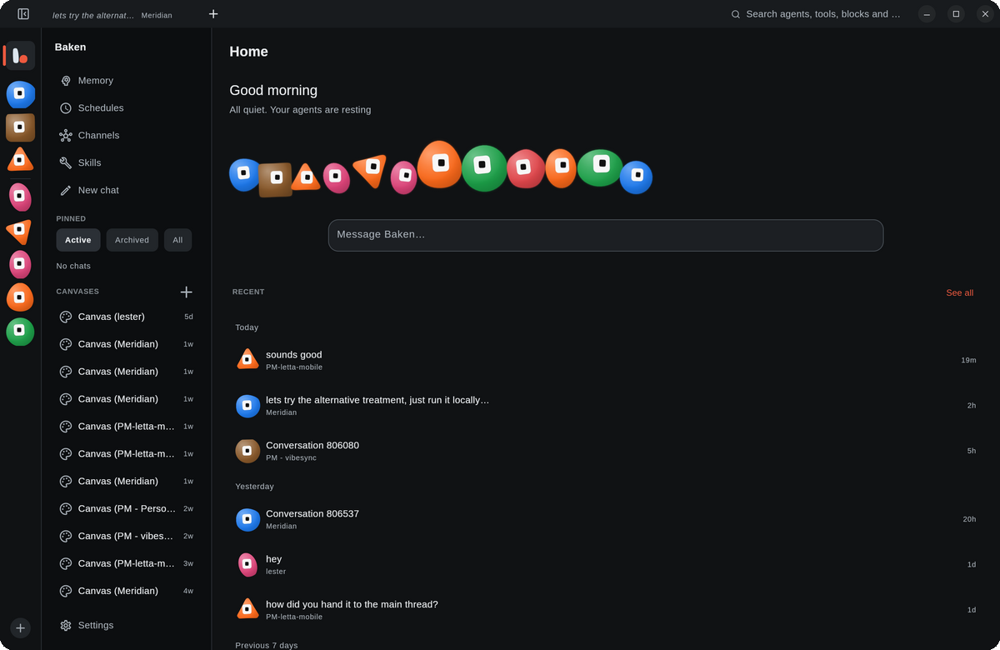

<p align="center">
  <picture>
    <source media="(prefers-color-scheme: dark)" srcset="docs/brand/baken-mark-dark.svg">
    
  </picture>
</p>

<h1 align="center">Baken</h1>

<p align="center"><strong>Agents that run on your own machine.</strong></p>

<p align="center">
  <a href="https://baken.ca">baken.ca</a> ·
  <a href="https://baken.ca/docs/">Docs</a> ·
  <a href="https://github.com/oculairmedia/baken/releases/latest">Download</a>
</p>

<p align="center">
  
</p>

Baken is a native app for talking to AI agents that live on a computer you own. The agent, its
memory and its tools stay on your hardware, and you reach the same agent from your phone, your
desktop or a browser: pick up a conversation on one and carry on from the other. There is no
account, no subscription and no Baken-operated server.

## Built on Letta

Baken is powered by [Letta](https://www.letta.com), the stateful-agent technology behind the best
long-lived agents. Letta agents are [stateful](https://docs.letta.com/concepts/stateful-agents):
they keep their identity and memory over time, across models and machines, and get better with use
by managing their own context. Baken runs the open-source Letta Code harness on your host and puts
a native client in front of it, so everything Letta gives an agent comes with you:

- **Memory that is yours to read.** Each agent keeps a git-versioned memory filesystem
  ([MemFS](https://docs.letta.com/concepts/memfs)): plain files on your machine that the agent
  writes, reorganizes and learns from, and that you can open and edit.
- **One memory across every conversation and device.** Start a thread on your phone, continue it
  on your desktop; the agent remembers both.
- **Skills, schedules and subagents.** Agents learn reusable skills, run scheduled tasks and spawn
  subagents to work in parallel.
- **Dreaming.** Between conversations, agents reflect and tidy their memory in the background.

What Baken adds on top: native Android, Windows and Linux apps, direct end-to-end encrypted pairing
with your host, voice, background tasks you can follow from anywhere, and a shared canvas.

## What you can do

<table>
  <tr>
    <td width="50%" valign="top">
      <br>
      <strong>Talk to your agents.</strong> Replies stream in with the agent's work shown step by
      step, and you can switch to voice at any time.
    </td>
    <td width="50%" valign="top">
      <br>
      <strong>All your agents in one place.</strong> See each agent's model and how much of its
      context it is using, and jump to its memory, schedules, channels, skills or past
      conversations.
    </td>
  </tr>
  <tr>
    <td width="50%" valign="top">
      <br>
      <strong>See what your agent remembers.</strong> Browse the memory an agent keeps on your
      host, the same files it reads before it answers.
    </td>
    <td width="50%" valign="top">
      <br>
      <strong>Pick up where you left off.</strong> Home gathers your agents and recent work so you
      can get back into a task in one tap.
    </td>
  </tr>
</table>

<p align="center">
  
</p>

**Same agents on the desktop.** The Windows and Linux apps share the phone's design and talk to
the same agents, with room for a wider workspace.

Agents also use your host's files, terminal, browser and local apps under one of four permission
modes, run long tasks in the background while the chat stays usable, and hand work to each other.

## How it works

1. **Run your host.** Start [letta-code](https://docs.letta.com) and the Baken host wrapper on a
   Linux or Windows machine you control.
2. **Pair your devices.** Open Baken on your phone or desktop and scan the QR code from your host.
   The connection is encrypted end to end and goes direct when it can; when it can't, it falls back
   to a relay that cannot read the traffic.
3. **Chat.** Your agents, their memory and their history are there on every paired device.

## Download

Every release is on [GitHub Releases](https://github.com/oculairmedia/baken/releases/latest):

| Platform | Package |
|---|---|
| Android 8.0+ | `full` APK (includes an on-device runtime) or `lite` APK |
| Windows x64 | `.exe` or `.msi` installer |
| Linux x64 | AppImage |
| Agent host (Linux x64) | `meridian-iroh-wrapper` |

<a href="https://apps.obtainium.imranr.dev/redirect.html?r=obtainium://add/https://github.com/oculairmedia/baken/releases" target="_blank"></a>

A browser client runs on [GitHub Pages](https://oculairmedia.github.io/baken/).

The source here is currently **source available**: you can read, build and run it for your own
use; all other rights are reserved until a licence is published
([baken.ca/licenses](https://baken.ca/licenses/)). "Baken" and the Baken mark are covered by the
[brand guidelines](https://baken.ca/brand/); if you distribute a modified build, give it a
different name.

## For contributors

This repository holds all three Baken clients, the agent-host wrapper and their shared code.
Baken is a Kotlin Multiplatform project: one shared domain module (`sharedLogic`) and one shared
Compose UI module (`sharedUI`) power Android, desktop and the browser, and each platform module is
a thin host binding. Internal identifiers (the `com.letta.mobile` package, the `letta-mobile`
repository and module paths, the `meridian` CLI and wrapper names, the `meridian://` link scheme)
are unchanged on purpose: renaming them would orphan existing installs and break update paths.
The display name and icons come from one source, [`android-compose/branding/`](android-compose/branding/brand.properties).

Documentation index and lifecycle conventions: [docs/README.md](docs/README.md).
Historical planning and experiments live in [plan/](plan/) and [poc/](poc/).

## Features

- **Agent management** — create, edit, clone, import, delete, and organize agents; one shared agent editor and new-agent flow used by every client
- **Rich chat** — tool outputs, code blocks, reasoning display, mermaid diagrams (native renderer), and a real-time assistant work timeline
- **Interactive tools** — `AskUserQuestion` and `ExitPlanMode` surface to the user with full submit/approve wiring
- **Approvals and permission modes** — pending approvals relay to every connected client; permission mode changes push live rather than waiting for a reconnect
- **Subagents** — roster and progress for delegated work, including a running subagent's step detail
- **Memory administration** — core memory blocks, memory files and the pan/zoom memory graph on the shared memory workspace (`sharedUI`); on Android the `MemoryOverviewScreen` entry point in `app/` hosts that shared workspace
- **Admin tooling** — providers, tools, skills, templates, projects, channels, schedules, runs, telemetry, system access, pairing and config
- **Canvas and notes** — a shared canvas workspace with the vendored DrawBox editor, peer-owned documents synced across collaborators, plus Dreaming reflection settings; agents draw with `canvas_apply_ops` and lay out notes, checklists and cards by meaning with `canvas_compose`
- **Canvas plugins** — new canvas element kinds and agent tools from process plugins over LCP, with live tool re-advertisement. The Kotlin JVM SPI and service framing are declared contracts; JVM JAR and service executors remain proposed. See the [implemented host subset](docs/reference/plugin-trust-model.md).
- **Live sync** — multi-client conversation sync between mobile, desktop and browser, paired-device authz, agent-to-agent messaging
- **Shell** — one adaptive shell across clients: unified search, connection state, a live dock mascot, and pull-to-refresh on list surfaces

The cross-client surfaces above are shared Compose UI in `sharedUI` and shared logic in
`sharedLogic`; the platform modules supply navigation hosts, DI, persistence and OS integration.
The exception is Android chat: `feature-chat` is an Android-only Compose module that owns the
Android chat screen and scaffold (the `AdminChatViewModel` stack) and composes `sharedUI`
components inside it.

Since the hard cuts that removed the HTTP/REST backend, the REST-only admin screens — archival
passages, block library, MCP servers, tool editor, model browser and usage — are **gone with no App
Server route behind them**. Their data-layer repositories remain in `sharedLogic` where a shared
surface still uses them. Do not re-add these screens without an App Server route to back them.

## Module layout

App modules live under [`android-compose/`](android-compose/); repository-level tooling and
architecture docs live in [`scripts/`](scripts/) and [`docs/`](docs/). Every Gradle module is
declared in [`android-compose/settings.gradle.kts`](android-compose/settings.gradle.kts).

The structure is shared-first: portable domain and UI implementations live in the shared
modules; `app/` provides the Android host rather than owning the whole product.

| Path | Purpose |
|---|---|
| `sharedLogic/` | KMP domain, repositories, timeline, and transport logic (`commonMain`, `jvmAndAndroid`, host-native and wasmJs targets) |
| `sharedUI/` | KMP Compose UI shared by Android, desktop and browser: shell, chat, agent editor, memory, providers, schedules, canvas, search, settings, A2UI rendering |
| `sharedUI-devfixtures/` | Deterministic UI fixtures for `sharedUI` previews and tests |
| `app/` | Android host: navigation graph, Hilt DI, ViewModels, thin containers around shared pages |
| `desktop/` | Compose Desktop host: entry point, single-instance/OS lock, bundled JBR runtime, installers |
| `web/` | Browser client (Kotlin/WASM, Compose for Web) |
| `feature-chat/` | Chat feature UI, presentation state and coordination (the `AdminChatViewModel` stack) |
| `designsystem/` | Reusable Compose UI, theming, and dialogs |
| `core/android-data/` | Android data bindings, repositories, Room database, data sources |
| `core/data/` | Shared Android/JVM Room entities, DAO contracts and model conversions |
| `core/runtime/` | Portable runtime contracts, IDs, projection and outbox; AppServerTurnEngine/fanout implementations live in sharedLogic |
| `core/ids/` | Shared identifiers; wire schemas are source packages under `core/schemas/`, not a `:core:schemas` Gradle module |
| `core/testutil/` | Shared test doubles and harnesses |
| `plugin-api/` `plugin-api-testkit/` `plugin-view/` | The Kotlin SPI a JVM-runtime canvas plugin implements (its DTOs are the LCP wire shapes), the conformance test kit for plugin authors, and the WebView host that renders a plugin's UI |
| `avatar/core/` `avatar/renderer-rive/` | Avatar models and Rive rendering |
| `drawbox/` | Vendored canvas editor used by the shared canvas workspace (`drawbox/VENDORED.md`) |
| `cli/` `appserver-cli/` `iroh-wrapper-cli/` | JVM tooling, App Server contract probes, and the Iroh server wrapper that ships as `meridian-iroh-wrapper` |
| `appserver-testkit/` | Shared Android/JVM smoke-run scenarios for CLI diagnostics and instrumented tests |
| `quality/detekt-rules/` `architecture-tests/` | Static-analysis rules and module-boundary tests |
| `macrobenchmark/` `baselineprofile/` `perf/` `native/` | Performance infrastructure and native libraries |
| `build-logic/` | Convention plugins: `com.letta.mobile.android.library` for Android library modules, `com.letta.mobile.kmp.library` (`KmpLibraryPlugin.kt`) for the KMP target defaults, plus the architecture-graph, embedded-runtime and JNI 16 KB plugins |

`core/docs/` is documentation, not a module.

The cardinal rule: **portable feature logic lives in `sharedLogic/commonMain`; shared
Compose UI lives in `sharedUI`; platform modules provide host-specific bindings.** The
required `shared-multiplatform` check runs bounded `:sharedLogic:jvmTest`, wrapper/CLI tasks,
and host-native and wasmJs *compiles* rather than `:sharedLogic:allTests` or `:desktop:test`.
Desktop and `:sharedUI:jvmTest` run additively in `test` when their trees change; browser tests
run only in the non-required `web-wasm` job.

## Transport

The App Server gateway is the only client transport. The former HTTP/REST Letta backend has been
removed, so a client cannot fall back to REST: an App Server change that alters a frame requires a
matched wrapper and client deploy (see Development notes). Remote App Server traffic travels over
Iroh QUIC to the host wrapper, which bridges to the runtime's loopback WebSocket; canvas relay,
sync and presence use separate Iroh ALPNs. See the generated
[App Server protocol and admin ownership reference](docs/reference/current-app-server-protocol.md).

## Runnable entry points

| Platform | Command (from `android-compose/`) |
|---|---|
| Android (dev) | `./gradlew :app:assembleRootDebug` — the `root` distribution flavor; `play` and `sideload` also exist (see [`android-compose/README.md`](android-compose/README.md)) |
| Android (release-shaped) | `./gradlew :app:assemblePlayRelease` |
| Compose Desktop | `./gradlew :desktop:run` |
| Phone UI on desktop | `./gradlew :desktop:runPhone` (live backend) / `:desktop:runPhonePlayground` (fixtures); `…Hot` variants add hot reload — see [`phone-preview.md`](docs/development/phone-preview.md) |
| Browser WASM | `./gradlew :web:wasmJsBrowserDevelopmentRun`; CI runs `:web:wasmJsBrowserDistribution` and `:web:wasmJsBrowserTest` (job `web-wasm`) |
| Iroh wrapper (the deployed server) | `./gradlew :iroh-wrapper-cli:installDist` → `iroh-wrapper-cli/build/install/meridian-iroh-wrapper/bin/meridian-iroh-wrapper app-server-serve-iroh …` |
| CLI / probes | `./gradlew :cli:run -PcliArgs="…"`; App Server contract probes via `:appserver-cli` (see [`kmp-phase-6-entrypoints.md`](docs/architecture/kmp-phase-6-entrypoints.md)) |

`:cli` is a plain Kotlin/JVM `application` module (the developer `meridian` CLI): `:cli:run`
takes `-PcliArgs="…"` (Gradle's own `--args` also works), and `:cli:installDist` builds
`cli/build/install/meridian/bin/meridian`. The deployed server binary comes from
`:iroh-wrapper-cli`. The `app-server-iroh-probe` and `app-server-iroh-two-client-probe` commands
live in `:cli`.

Full notes: [`docs/architecture/kmp-phase-6-entrypoints.md`](docs/architecture/kmp-phase-6-entrypoints.md).

## Further reading

| Topic | Doc |
|---|---|
| Letta's own docs (agents, memory, App Server) | [`docs/reference/letta-docs.md`](docs/reference/letta-docs.md) |
| A2UI renderer and catalog authoring | [`sharedUI/…/ui/a2ui/README.md`](android-compose/sharedUI/src/commonMain/kotlin/com/letta/mobile/ui/a2ui/README.md) |
| `canvas_compose` contract | [`docs/reference/canvas-compose-v1.md`](docs/reference/canvas-compose-v1.md) |
| Canvas plugin platform | [plan](docs/design/canvas-plugin-platform-plan.md), [LCP wire v1](docs/reference/canvas-plugin-wire-v1.md), [view bridge v1](docs/reference/plugin-view-bridge-v1.md) |
| Live external tools | [`docs/architecture/live-external-tools.md`](docs/architecture/live-external-tools.md) |
| KMP module map | [`docs/architecture/kmp-module-map.md`](docs/architecture/kmp-module-map.md) |
| Generated Kotlin API reference | [Published API docs](https://oculairmedia.github.io/baken/api/) (after the next successful main deployment); [generation guide](docs/development/api-documentation.md) |
| Releasing | [`docs/RELEASE.md`](docs/RELEASE.md) |

## Quick start

```bash
git clone https://github.com/oculairmedia/baken.git
cd letta-mobile
./scripts/install-hooks.sh          # activate .githooks/ via core.hooksPath

cd android-compose
cp -f local.properties.example local.properties
# Set JAVA_HOME using the platform-specific instructions in CONTRIBUTING.md.
./gradlew :app:assembleRootDebug    # Android APK (root flavor)
./gradlew :desktop:run              # Compose Desktop (needs JDK 26, Rust toolchain, and a display)
```

See [`CONTRIBUTING.md`](CONTRIBUTING.md) for full setup instructions (Linux, macOS, Windows).

## Pre-push PR readiness

CI takes ~20 minutes per iteration. The most common reasons PRs loop through review iterations
are stale-base rollbacks, mechanical detekt debt, and missing concurrent-collection defaults —
all catchable at dev cost in seconds. **Run the checklist in [`AGENTS.md`](AGENTS.md) before
opening a PR.**

## Required CI gates

`main` is protected; PRs must pass all of:

- `test` — module unit tests, policy scripts, the parity guardrails, `web-wasm`, and additive module tests (`:sharedUI:jvmTest`, `:desktop:test`, `:designsystem`, `:feature-chat`, `:cli`, `:plugin-*`, …): all of them on every main push, and on PRs those of each changed module and every module depending on it ([`scripts/ci/changed-gradle-modules.sh`](scripts/ci/changed-gradle-modules.sh))
- `build-apk-pass` — Android APK build (stable aggregator of the `build-apk` matrix)
- `detekt` — `./gradlew detekt --continue -Parchitecture.strict=true` against each module's `detekt-baseline.xml`; any finding outside a baseline fails, including in files the PR did not touch. Detekt is strict by default locally too; CI retains the old flag harmlessly
- `shared-multiplatform` — bounded `:sharedLogic:jvmTest` (12 min), wrapper/CLI verification, and host-native and wasmJs *compiles* (main + test) for `:sharedLogic` and `:sharedUI`; no browser tests (`:web:wasmJsBrowserTest` runs in `web-wasm`, which the required `test` aggregates). Exact tasks: [`.github/workflows/android.yml`](.github/workflows/android.yml)

Coverage uploads run on `main` via `codecov.yml`, not as a required PR check.
`perf-gate` (emulator startup macrobenchmark) is **not** a PR gate: it runs nightly, on pushes to `main`, and on PRs that edit the perf gate itself; other PRs run only the cheap `perf-scripts` self-test ([`docs/performance/perf-gate.md`](docs/performance/perf-gate.md)).
The platform UI and parity guardrails run inside the required `test` check (no unshared frontend or logic; see `AGENTS.md`).
**Advisory only** (findings never fail): CodeScene Code Health Review, `Advisory AGENTS.md policy`, `row goldens (advisory)`. Full table: "CI map" in [`AGENTS.md`](AGENTS.md).

## Releases

Versioning is **tag-driven**. `vX.Y.Z` is the single source of truth for `versionName` and
`versionCode`. CI builds on tag push and creates a GitHub Release. Each release ships a
signed Android APKs (`full` with embedded runtime and `lite` without it), Windows desktop installers (`.exe` + `.msi`),
and a Linux Iroh wrapper distribution. Pre-release suffix: `v0.2.0-rc.1`. See [`CONTRIBUTING.md`](CONTRIBUTING.md) for the full
release flow.

## Development notes

- Issue tracking is **bd** (beads) — `bd ready`, `bd show <id>`, `bd update <id> --claim`.
  Never commit `.beads` artifacts.
- The docs are checked against the tree in the required `test` job:
  [`scripts/ci/docs-freshness-check.py`](scripts/ci/docs-freshness-check.py) fails when a Gradle
  module is missing from the module tables, a Gradle task path names no module, the required-gate
  list here differs from `scripts/bootstrap-branch-protection.sh`, a relative link breaks, or a
  quoted Gradle version differs from the wrapper. Run it locally before pushing doc changes.
- The pre-push hook blocks pushes to `main`/`master` and checks `JAVA_HOME`. Kotlin compile is **opt-in** (`PRE_PUSH_COMPILE=1`) — off by default so cold Gradle configure cannot OOM the shared host; CI owns the compile gate.
- Anything touching `sharedLogic` **App Server transport** requires a matched wrapper + APK deploy.
  There is no REST fallback to catch a mismatched pair.
- `main` moves by **hard cuts**: a shared page lands and the Android screen it replaces is deleted in
  the same PR, guarded by parity harnesses (`row-parity`) and the `platform-ui-gate` ratchet. When a
  page seems to be missing from `app/`, look for it in `sharedUI/` first.
