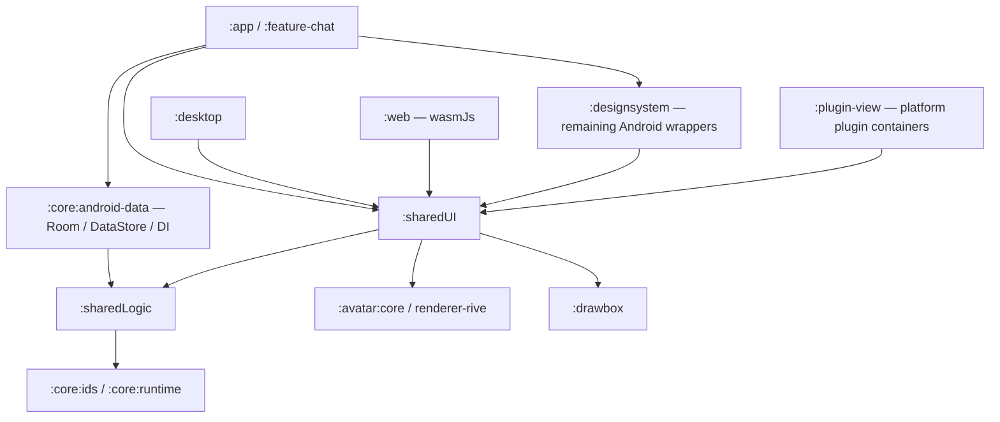
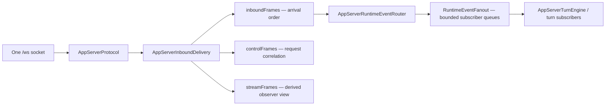
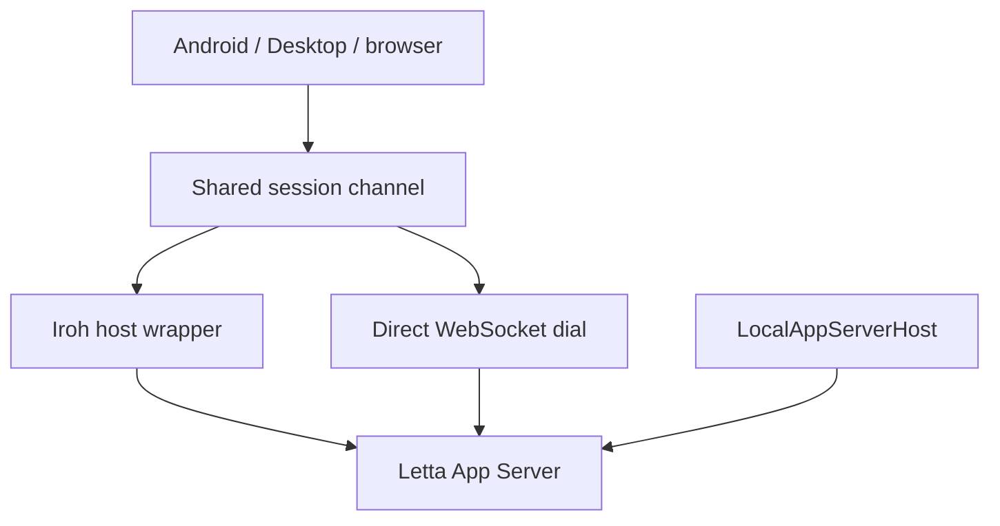

# Letta Mobile Architecture Diagrams

**Status:** Current structural diagrams; audited against module builds and transport implementations on 2026-10-18.

## Product modules

This diagram shows major dependencies, not every test or source-set edge. [Gradle settings](../../android-compose/settings.gradle.kts) and the [module map](kmp-module-map.md) include all projects. The former `:bot`, `:core`, `:feature-admin`, `:feature-home`, `:feature-settings` and `:plugin-host` nodes are not current Gradle projects.

## App Server connection and frame delivery

[KtorAppServerWebSocketTransport](../../android-compose/sharedLogic/src/commonMain/kotlin/com/letta/mobile/data/transport/appserver/KtorAppServerWebSocketTransport.kt) owns one connection generation. [AppServerInboundDelivery](../../android-compose/sharedLogic/src/commonMain/kotlin/com/letta/mobile/data/transport/appserver/AppServerInboundDelivery.kt) preserves arrival order for the main path; do not merge the two derived views to reconstruct that order. A full transport queue fails the generation. [RuntimeEventFanout](../../android-compose/sharedLogic/src/commonMain/kotlin/com/letta/mobile/data/controller/fanout/RuntimeEventFanout.kt) uses nonblocking offers and detaches a full subscriber, isolating that subscriber from other runtimes.

## Hosting and client paths

Android's embedded launcher runs libnode in process; JVM hosts launch a process. Both use [LocalAppServerHost](../../android-compose/sharedLogic/src/commonMain/kotlin/com/letta/mobile/data/runtime/host/LocalAppServerHost.kt). The production host wrapper is `:iroh-wrapper-cli`; `:appserver-cli` supervises/probes an App Server and is a separate artifact. See [deployment guide](app-server-controller-deploy.md).
